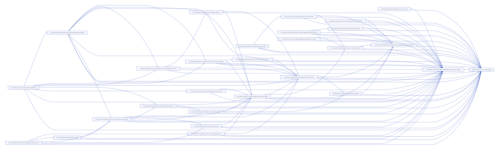

# План реализации: 1.3.0

## 1. Кратко

Версия 1.3.0 · MINOR — переносимое продолжение, приём изменённых макетов и малая итерация с чтением прежних проектов. Текущий manifest — 1.2.266; его обновляет последний U28.

Brownfield/fix по всем A01–A34 из [audit-scope.md](audit-scope.md). У этого источника нет версии: pin оставлен без выдуманного @version. Исходный HEAD: `338db42db5822d2369a6de8e22c060632f6e0616`; свидетельства рабочего дерева и ограничения — в audit-scope.md. SRS/API/schema продукта отсутствуют и для этого плана не требуются.

Дополнение [reflect-supplement.md](reflect-supplement.md), также без версии: R01 — конечный согласованный объём в U8; R02 — синхронизация отмены до dispatch в U8/U16; R03 — проверка последнего stamp и регрессии в U12. U27 учитывает их доказательства; A01–A34, грейды, зависимости и волны сохранены. Локальный stamp-патч установленной копии не означает исправления исходника; реализация и R/B-прогоны здесь не выполнялись.

Архитектура по исходникам: stdlib CLI/hooks и Markdown-правила без слоёв приложения. Инвентарь — pipeline/work/reflect scripts, shell hooks, agent TOML и шесть unittest modules. Есть temp Git repos, temp CODEX_HOME, subprocess CLI и importlib fixtures; заново создавать каркас не нужно. Основа плана — сохранность состояния и Git, затем workflow/reflect, правила и сквозная приёмка. Три юнита сохранности/владения/Git recovery имеют High; грейд планировщика не определяет грейд реализации.

Сейчас меняются только файлы плана. Чужие изменения AGENTS.md, README.md и agent TOML остаются отдельно принадлежащими правками; существующие файлы не переименовывать/не перемещать. Источник истины — Codex-репозиторий, без синхронизации Claude/установленных копий и без codex/build.py/claude/tools/codex_sync.py.

Каждый пакет читает затронутые пути/разделы и необходимые общие зависимости. Ориентир — около 250 тысяч токенов вместе с реализацией, проверкой и исправлениями, меньше при меньшем окне; выдуманных оценок по юнитам нет. Если реальный вход не помещается с запасом, разделить до dispatch. U20/U26 — определённые однородные Markdown-проходы, а не проектирование нескольких областей.

Ревью: 0 — проверка оркестратора; Low — завершённые совместимые партии с точными ID и HEAD range, исправления проверяются до закрытия партии; Mid — один профильный проход; High — основное и независимое риск-ревью. Общего назначения High-review нет; модели/effort не менять. Границы прогонов и финальное full-run review обязательны.

Сценарии помечены R — executable unittest/static/CLI regression; B — будущий кейс именованного агента в `tests/behavior_cases/*.md`, не запускаемый unittest; L — реальная приёмка host/Figma/Docker. Статические проверки прозы доказывают наличие/маршрутизацию, не исполнение агентом. При планировании B/L не запускались. U27 фиксирует реальный результат и prerequisites; недоступность — BLOCKED/NOT_RUN, никогда PASS. Только обезличенные fixtures; реальные rollouts/ID/credentials не коммитить. Git-пробы — временные репозитории с local origin.

## 2. Карта юнитов

| U | Юнит | Сложность | Исполнитель | Вложенный | Зависит от | Параллельно |
|---|---|---|---|---|---|---|
| U1 | Привязать состояние к checkout соответствующей ветки | High | impl-hard | — | — | no — общий контракт пути для последующих потребителей |
| U2 | Сохранять полный checkpoint без потери правок и двойного восстановления | High | impl-hard | — | U1 | no — основа владения и сохранности для workflow |
| U3 | Останавливать отправку при несохранённых отчётах и проверять remote HEAD | Mid | impl-medium | — | U1,U2 | no — тот же push_branch будет изменён U4 |
| U4 | Восстанавливать Git после конфликтов и пересобирать только общий сайт | High | impl-hard | — | U3 | no — общий Git индекс, recovery и push_branch |
| U5 | Отделить предложенные этапы от разрешённых и свободно выбирать исполнителя | Mid | impl-medium | — | U1,U2 | no — subsessions и parent-session изменяются далее |
| U6 | Восстанавливать активный этап по устойчивому состоянию | Mid | impl-medium | — | U2,U5 | no — hook и общий контракт возобновления |
| U7 | Согласовать CLI измерения контекста с запасом следующей задачи | Low | impl-lite | — | U10 | no — context.md позднее использует workflow checkpoint |
| U8 | Применить checkpoint ко всем фазам разработки и финального ревью | Low | impl-lite | — | U2,U3,U6,U7,U12,U13,U14,U15,U16 | no — work close/run-state имеют несколько согласуемых потребителей |
| U9 | Согласовать правила передачи, Git и работу нескольких участников | Low | impl-lite | — | U1,U2,U3,U4,U5,U6,U7,U8,U12 | no — общие workflow документы и consent |
| U10 | Нормализовать Codex-сообщения и единообразно находить сессии | Mid | impl-medium | — | — | yes — только независимые U17,U19,U22,U24,U25 в волне1 |
| U11 | Извлекать реальные ошибки вложенных команд | Mid | impl-medium | — | U10 | no — sessions.py parser общий с U12 |
| U12 | Вычислять непересекающиеся окна reflect и проверять их при закрытии | Mid | impl-medium | — | U2,U10,U11 | no — sessions и close_iteration меняют следующие юниты |
| U13 | Отделить guardian и связать расход с попытками задач | Mid | impl-medium | — | U10,U12 | no — общий формат окон и итогов reflect |
| U14 | Оформлять небольшую правку как определённую малую итерацию | Mid | impl-medium | — | U1,U12 | no — open/close scripts используются общими gate |
| U15 | Привязать выборочную UI-приёмку к изменённому коду и кейсам | Mid | impl-medium | — | U12,U14 | no — close_iteration и close.md меняются U8 |
| U16 | Ограничить мутации заранее и сохранять обязательное риск-покрытие | Mid | impl-medium | — | U1 | no — итоговые проверки и бюджет согласуются до U8 |
| U17 | Проверять каждый релизный образ и полноту отчётов Trivy | Low | impl-lite | — | — | yes — только независимая группа волны1 |
| U18 | Добавить приём изменённых макетов без перенумерации | Low | impl-lite | — | U9,U15 | no — ui-test-cases и handoff правила уже согласованы |
| U19 | Зафиксировать общий контракт ошибок БД и защиты границ | Low | impl-lite | — | — | yes — только независимая группа волны1 |
| U20 | Подключить единые правила в серверных и клиентских навыках | 0 | mechanical-worker | — | U19 | no — react и backend навыки использует U21/U26 |
| U21 | Согласовать React-инвалидацию, версии lint и совместимость union | Low | impl-lite | — | U8,U20,U25 | no — React и stack-skills общий контракт чтения |
| U22 | Ограничить архитектурный increment и уважать заданный облегчённый уровень | Low | impl-lite | — | — | yes — только независимая группа волны1 |
| U23 | Проверять запрещённые архитектурные термины механически | Mid | impl-medium | — | U22 | no — architecture final-check принимает закреплённую политику |
| U24 | Проверять экономику и вместимость плана без дробления на микроюниты | Mid | impl-medium | — | — | yes — только независимая группа волны1 |
| U25 | Сократить пакеты чтения и задать проверяемый эксперимент строгого ревью | Low | impl-lite | — | — | yes — только независимая группа волны1 |
| U26 | Применить короткие указатели правил и убрать устаревшие действующие инструкции | 0 | mechanical-worker | — | U8,U9,U18,U20,U21,U22,U23,U24,U25 | no — единый механический проход по уже установленным правилам |
| U27 | Проверить оба сценария передачи между людьми и честно записать приёмку | Mid | impl-medium | — | U1,U2,U3,U4,U5,U6,U7,U8,U9,U10,U11,U12,U13,U14,U15,U16,U17,U18,U19,U20,U21,U22,U23,U24,U25,U26 | no — сквозная приёмка фиксирует единственное состояние исходника |
| U28 | Подготовить версию 1.3.0 после проверок | 0 | mechanical-worker | — | U1,U2,U3,U4,U5,U6,U7,U8,U9,U10,U11,U12,U13,U14,U15,U16,U17,U18,U19,U20,U21,U22,U23,U24,U25,U26,U27 | no — последний общий manifest gate |

[Исходник D2](diagrams/deps.d2).

## 3. Юниты

### U1. Привязать состояние к checkout соответствующей ветки

| | |
|---|---|
| **Документы** | documentation/plans/1.3.0/audit-scope.md A20; code:dev-pipeline/skills/pipeline/scripts/open_iteration.py; code:dev-pipeline/hooks/guard.py |
| **Файлы** | `dev-pipeline/skills/pipeline/scripts/state_paths.py` (новый); `dev-pipeline/skills/pipeline/scripts/open_iteration.py`; `dev-pipeline/skills/pipeline/scripts/where_am_i.py`; `dev-pipeline/skills/pipeline/scripts/subsessions.py`; `dev-pipeline/skills/work/scripts/plan_state.py`; `dev-pipeline/hooks/guard.py`; `tests/test_codex_compat.py`; `tests/test_state_paths.py` (новый) |
| **Меняет символы** | Корни plans/local sessions; open_iteration.LOCAL; guard main_root/linked-worktree policy; plan_state main_tree fallback. Существующие command signatures сохранены. |
| **Не затрагивается** | doc-versioning/scripts/doc_state.py, doc_check.py и docs-consistency/scripts/pins.py вызывают прежний where_am_i registry/stamp API. progress_page.py, progress_link.py, docs-consistency/SKILL.md, plan/SKILL.md, repo-scaffold/SKILL.md, upgrade-docs/changes.json сохраняют CLI. Historical upgrade evidence не текущая path policy; U9/U26 позже меняют лишь инструкции. |
| **Образец** | `dev-pipeline/skills/pipeline/scripts/open_iteration.py`; `tests/test_codex_compat.py` |
| **Зависит от** | — |
| **Параллельно** | no — общий контракт пути для последующих потребителей |
| **Сложность** | High |
| **Почему** | rule 1 — миграция состояния и изоляция существующих checkout |
| **Исполнитель** | impl-hard |
| **Вложенный** | — |
| **Что делает вложенный** | — |

**Цель** — Все переносимые планы принадлежат текущему checkout iteration-ветки; локальные ID и процессы не пересекаются между checkout/чатами.

**Подход** — Ввести общий resolver: переносимый корень — git --show-toplevel запрошенного checkout; локальный — его --absolute-git-dir/pipeline-work/<version>/<chat-key>, без неизолированного common-dir. Не читать и не менять изменяемые plans другого checkout. Старые sessions.md/common-dir читать через явный fallback; копировать только локально после проверки идентичности, сохраняя источник и не выводя согласие на передачу. При отсутствии плана предлагать fetch/switch/integrate, а не править main checkout. Сохранить перенос старых ignored plans.

**Тестовые сценарии**

- R: два worktree с разными версиями воспроизводят guard/plan_state mismatch; каждый видит лишь свою ветку.
- R: tests/test_codex_compat.py заменяет разрешение записи ../../documentation/plans/1.0/progress.md в foreign main на deny; запись внутри текущего worktree разрешена, escape/symlink проверки сохранены.
- R: runtime ID двух чатов/worktree изолированы.
- R: старые ignored plans/local files читаются, миграция идемпотентна и не правит чужой checkout.
- R property: любой корректный checkout разрешает portable paths внутри себя, local paths — внутри своего gitdir; invalid/missing repo явно отвергается.

**Проверка** — Временные репозитории доказывают отсутствие cross-main mutation и продолжение старых проектов; существующие CLI consumers проходят.

**Коммит** — `fix: isolate iteration state because worktrees read another checkout`.

### U2. Сохранять полный checkpoint без потери правок и двойного восстановления

| | |
|---|---|
| **Документы** | documentation/plans/1.3.0/audit-scope.md A01,A02,A10,A29; code:dev-pipeline/skills/pipeline/references/pause-and-resume.md |
| **Файлы** | `dev-pipeline/skills/pipeline/scripts/checkpoint.py` (новый); `dev-pipeline/skills/pipeline/references/checkpoint-state.md` (новый); `tests/test_checkpoint.py` (новый); `tests/behavior_cases/checkpoint.md` (новый) |
| **Меняет символы** | Новая версионированная checkpoint/run-state схема и CLI; существующие public symbols не удаляются. |
| **Не затрагивается** | — |
| **Образец** | `dev-pipeline/skills/pipeline/scripts/state_paths.py` (U1); `tests/test_codex_compat.py` |
| **Зависит от** | U1 |
| **Параллельно** | no — основа владения и сохранности для workflow |
| **Сложность** | High |
| **Почему** | rule 1 — сохранность незакоммиченного состояния и смена владельца |
| **Исполнитель** | impl-hard |
| **Вложенный** | — |
| **Что делает вложенный** | — |

**Цель** — Checkpoint сохраняет staged/unstaged/new/binary состояния проверяемо, не меняя исходный индекс/дерево, и различает местное продолжение и переносимую передачу.

**Подход** — Одновременно описать checkpoint-state.md и реализовать схему. Атомарный manifest содержит schema version, логические run/checkpoint ID, branch/full HEAD/plan hash, phase/next action, review BASE..HEAD, Low batches/ranges/findings, decisions/completeness. Переносимые run-state.json/work-run.md/resume/context-handover лежат в plans этого checkout; физические host/thread/process ID и журналы — только локально. CHECKPOINT/HANDOVER/RESUME/COMPACT связывают логические source/successor, локальная карта — реальные host ID. Snapshot сохраняет отдельные staged/unstaged binary deltas, untracked bytes/modes и хеши файлов; без intent-to-add/reset. Сверять inventory до/после, отвергать concurrent drift и неполный capture. Чужие правки сохранять локально; в переносимые checkpoints/<id>/ включать лишь явно принадлежащий юниту проверенный payload. Неподдержанный submodule/unmerged index не позволяет объявить передачу полной. Исходное дерево не очищать/не сбрасывать. Restore только явно в соответствующий чистый checkout после проверки base/hash; точное восстановленное состояние — no-op, partial/divergent — остановка. Не забирать stale/unknown process ownership молча. Передача требует остановки всех writers/checks и подтверждения владения; CHECKPOINT сохраняет владельца и продолжает тот же чат. Старые resume/local patch остаются local-only.

**Тестовые сценарии**

- R сначала: staged-only, staged+unstaged одного файла, untracked text/binary, delete, executable и symlink воспроизводят пропуск старого patch; index/status/worktree bytes неизменны.
- R property: capture→restore в соответствующем чистом temp checkout сохраняет inventory/content/modes/index distinctions; повтор — no-op; corrupt/partial/wrong-base отвергаются.
- R: concurrent write, interrupted atomic save, lock/unsupported state сохраняют оригиналы и дают incomplete.
- R: clone получает весь owned payload из portable artifacts; legacy patch требует той же машины.
- B: active child/unknown owner блокирует передачу; обычный checkpoint не создаёт чат и не приостанавливает работу.

**Проверка** — Хеши, Git status и staged/unstaged inventory доказывают полноту/идемпотентность; схема содержит все фазы без утечки local identities.

**Коммит** — `fix: preserve full checkpoints because pause omitted staged changes`.

### U3. Останавливать отправку при несохранённых отчётах и проверять remote HEAD

| | |
|---|---|
| **Документы** | documentation/plans/1.3.0/audit-scope.md A03,A04; code:dev-pipeline/skills/pipeline/scripts/push_branch.py |
| **Файлы** | `dev-pipeline/skills/pipeline/scripts/push_branch.py`; `tests/test_push_branch.py` (новый) |
| **Меняет символы** | Результат commit_reports и исход main push; CLI/exit 0/1/2/3 сохранены, ошибка обязательного отчёта — nonzero. |
| **Не затрагивается** | CLI callers pipeline/SKILL.md, references/team.md, service-version.md, pause-and-resume.md, decision-changes.md; work/references/run-state.md, progress-file.md; docs-consistency/SKILL.md и grill-me/SKILL.md сохраняют вызов. U8/U9 уточняют обработку исхода; form_problems/doc_check неизменны. |
| **Образец** | `dev-pipeline/skills/pipeline/scripts/push_branch.py`; `tests/test_codex_compat.py` |
| **Зависит от** | U1,U2 |
| **Параллельно** | no — тот же push_branch будет изменён U4 |
| **Сложность** | Mid |
| **Почему** | rule 6 — проверка Git-результата через несколько границ |
| **Исполнитель** | impl-medium |
| **Вложенный** | — |
| **Что делает вложенный** | — |

**Цель** — Нельзя объявить передачу успешной, пока обязательные отчёты не в Git и нужная удалённая ссылка не подтверждена.

**Подход** — Возвращать явный результат сохранения отчётов. При занятом индексе, ошибке add/commit или оставшихся обязательных изменениях остановиться до fetch/rebase/push, сохранив staged работу. Индексировать лишь переносимые отчёты текущей итерации, без local snapshots/других версий. Сохранить полные local/remote ref OID; после операции проверить точный refs/heads/iteration/<v> через ls-remote либо однозначный porcelain updated ref. Различать отправлено/уже синхронизировано/не подтверждено; up-to-date недостаточно. Нет origin, auth/network/ref lookup failure — передача не выполнена. Остальные ветки не отправлять; без force/tags.

**Тестовые сценарии**

- R сначала: чужой staged file+dirty progress, failing commit hook/add failure дают nonzero, без remote mutation, staged bytes сохранены.
- R: новая ветка отправляет точный full OID; синхронизированная — already synchronized.
- R: ложный success/up-to-date с wrong/unavailable remote OID — unconfirmed/nonzero.
- R: advance/race local origin не подтверждает чужой SHA. Только local origin.

**Проверка** — Успех доказывает наличие обязательных отчётов в HEAD и равенство remote ref этому HEAD; все ошибки оставляют восстановимое local state.

**Коммит** — `fix: fail handoff because unsaved reports and push text hid failure`.

### U4. Восстанавливать Git после конфликтов и пересобирать только общий сайт

| | |
|---|---|
| **Документы** | documentation/plans/1.3.0/audit-scope.md A14; code:dev-pipeline/skills/pipeline/scripts/push_branch.py; code:dev-pipeline/skills/docs-site/scripts/rebuild.py |
| **Файлы** | `dev-pipeline/skills/pipeline/scripts/push_branch.py`; `dev-pipeline/skills/docs-site/scripts/rebuild.py`; `tests/test_push_branch.py`; `tests/test_site_rebase.py` (новый) |
| **Меняет символы** | Восстановление rebase/autostash в push_branch и результат rebuild без server; CLI entrypoints сохранены. |
| **Не затрагивается** | docs-site/SKILL.md и open-docs/SKILL.md сохраняют обычные build/serve; push callers сохраняют CLI, source document form checks неизменны. |
| **Образец** | `dev-pipeline/skills/pipeline/scripts/checkpoint.py` (U2); `dev-pipeline/skills/pipeline/scripts/push_branch.py`; `tests/test_codex_compat.py` |
| **Зависит от** | U3 |
| **Параллельно** | no — общий Git индекс, recovery и push_branch |
| **Сложность** | High |
| **Почему** | rule 1 — rebase и восстановление пользовательских правок при сбоях |
| **Исполнитель** | impl-hard |
| **Вложенный** | — |
| **Что делает вложенный** | — |

**Цель** — Конфликт только генерируемого сайта разрешается пересборкой из объединённых исходников; любой иной сбой оставляет проверяемое восстановление.

**Подход** — До Git-изменений проверить отсутствие merge/rebase, сохранить branch/full HEAD/index/worktree через U2 и точный объект stash, не полагаясь на autostash text. Не терять dirty/untracked правки. Если все unmerged paths внутри documentation/_web-docs, воспроизводимо пересобрать сайт из объединённых исходников и продолжить; любой исходный конфликт — stop/abort без догадок. Пересборка не запускает постоянный сервер; отсутствие инструмента/renderer и сбой сборки явны. Проверить abort/restore и исходный inventory. При сбое abort/stash restore сохранить stash/snapshot/rebase metadata, показать реальное состояние восстановления, не отправлять и не заявлять чистое восстановление. Не перехватывать существующий rebase. Remote подтверждать через U3.

**Тестовые сценарии**

- R сначала: два local-origin clone меняют разные source docs, конфликтуют generated site; итоговый rebuilt artifact содержит оба источника.
- R: source conflict даёт abort без догадок.
- R: staged/unstaged/untracked binary сохраняются при успехе/сбое.
- R: injected rebuild/rebase-abort/stash-restore failures показывают реальное состояние, сохраняют recovery objects и не push.
- R: missing build tool/existing rebase безопасно останавливают.
- R property: повтор recovery не применяет stash дважды.

**Проверка** — Temp repos показывают ожидаемое Git state и побайтовую сохранность правок при успехе и каждом recovery failure.

**Коммит** — `fix: recover site rebases because generated conflicts blocked parallel handoffs`.

### U5. Отделить предложенные этапы от разрешённых и свободно выбирать исполнителя

| | |
|---|---|
| **Документы** | documentation/plans/1.3.0/audit-scope.md A12,A19; code:dev-pipeline/skills/pipeline/scripts/subsessions.py |
| **Файлы** | `dev-pipeline/skills/pipeline/scripts/subsessions.py`; `dev-pipeline/skills/continue/SKILL.md`; `dev-pipeline/skills/pipeline/references/parent-session.md`; `tests/test_subsessions.py` (новый); `tests/behavior_cases/stage-selection.md` (новый) |
| **Меняет символы** | Схема subsession и authorization semantics plan/set/mark/show; STAGES keys/order/titles сохранены. |
| **Не затрагивается** | tests/test_model_policy.py проверяет STAGES/model parity; models.json/agent TOML неизменны, 02/04/12 сохранены. Исторический sessions.md — local evidence, не новое согласие. |
| **Образец** | `dev-pipeline/skills/pipeline/scripts/subsessions.py`; `dev-pipeline/skills/pipeline/scripts/state_paths.py` (U1); `tests/test_codex_compat.py` |
| **Зависит от** | U1,U2 |
| **Параллельно** | no — subsessions и parent-session изменяются далее |
| **Сложность** | Mid |
| **Почему** | rule 6 — локальная машина согласия и совместимость старых записей |
| **Исполнитель** | impl-medium |
| **Вложенный** | — |
| **Что делает вложенный** | — |

**Цель** — После continue/сжатия открываются только явно выбранные этапы, а история прежнего участника не ограничивает доступное меню.

**Подход** — Хранить proposed и explicitly authorized stage selection отдельно от opened/active/closed/handed-over локальных строк чатов. Создание требует зафиксированного выбора пользователя в текущем workflow; старые предложения unapproved, реальные opened rows остаются фактами. plan/show идемпотентны и не расширяют согласие; изменение авторизации явно, канонические названия стабильны. Свежий clone предлагает все готовые по требованиям этапы независимо от автора; владение файлами ограничено одновременными правками. Планирование и эти тесты не открывают чаты.

**Тестовые сценарии**

- R сначала: предложить 2/4/12, разрешить subset; повтор plan/show/resume возвращает лишь subset, старые rows читаются без расширения согласия.
- R property: любой subset сохраняет canonical numbers/order.
- R: foreign author history не фильтрует ready stages.
- B: выбор work после чужих docs, continue/compaction не создаёт невыбранные чаты; нет chat tools — тот же чат.

**Проверка** — State regressions доказывают idempotence/compatibility и точную границу согласия; B cases указывают authorization.

**Коммит** — `fix: retain chosen stages because resume reopened unapproved chats`.

### U6. Восстанавливать активный этап по устойчивому состоянию

| | |
|---|---|
| **Документы** | documentation/plans/1.3.0/audit-scope.md A11; code:dev-pipeline/skills/pipeline/scripts/keep_rules.py |
| **Файлы** | `dev-pipeline/skills/pipeline/scripts/keep_rules.py`; `dev-pipeline/hooks/session-start.sh`; `tests/test_keep_rules.py` (новый) |
| **Меняет символы** | Приоритет выбора stage keep_rules, optional state/thread lookup, hook invocation; старый transcript positional input допустим. |
| **Не затрагивается** | Формат keep_rules.sections/имена keep-after-compaction сохранены. Transcript skill mentions — неавторитетное compatibility evidence; другие hooks/role models неизменны. |
| **Образец** | `dev-pipeline/skills/pipeline/scripts/subsessions.py` (U5); `tests/test_codex_compat.py` |
| **Зависит от** | U2,U5 |
| **Параллельно** | no — hook и общий контракт возобновления |
| **Сложность** | Mid |
| **Почему** | rule 6 — приоритет устойчивого состояния над неоднозначной историей |
| **Исполнитель** | impl-medium |
| **Вложенный** | — |
| **Что делает вложенный** | — |

**Цель** — Чтение pipeline во время work не переключает памятку после сжатия.

**Подход** — Определять checkout/chat через состояние U1/U2, затем совпадающий active subsession; проверять iteration/stage identity. Нет состояния или оно противоречиво — честная общая инструкция восстановления; последнее чтение навыка не авторитетно. Старый transcript допустим лишь как помеченная подсказка, без замены известного этапа. Hook использует реальные host thread/cwd; отсутствие входа/журнала не ломает startup.

**Тестовые сценарии**

- R сначала: active work читает pipeline последним, hook печатает work rules.
- R: wrong thread/checkout, unknown stage/corrupt state/missing transcript дают явный безопасный fallback, не ложный этап.
- R: legacy invocation и shell syntax корректны.

**Проверка** — Временные hook subprocess выбирают saved stage и не создают/меняют другой run.

**Коммит** — `fix: recover active stage because last skill read selected wrong rules`.

### U7. Согласовать CLI измерения контекста с запасом следующей задачи

| | |
|---|---|
| **Документы** | documentation/plans/1.3.0/audit-scope.md A09; code:dev-pipeline/skills/reflect/scripts/context_size.py |
| **Файлы** | `dev-pipeline/skills/reflect/scripts/context_size.py`; `dev-pipeline/skills/pipeline/references/context.md`; `dev-pipeline/skills/pipeline/references/keep-after-compaction.md`; `tests/test_context_size.py` |
| **Меняет символы** | context_size.measure: next-task reserve/--next/--reserve и JSON fields; positional/--thread-id/--limit/--json и exit 0/2/3 сохранены. |
| **Не затрагивается** | reflect/SKILL.md лишь ссылается на reader, остаётся read-only; sessions.rollouts/meta/records сохранены U10. Host compact/clear tool не выдумывать. |
| **Образец** | `dev-pipeline/skills/reflect/scripts/context_size.py`; `tests/test_context_size.py` |
| **Зависит от** | U10 |
| **Параллельно** | no — context.md позднее использует workflow checkpoint |
| **Сложность** | Low |
| **Почему** | rule 5 — заданная формула, существующий CLI и прямые fixtures |
| **Исполнитель** | impl-lite |
| **Вложенный** | — |
| **Что делает вложенный** | — |

**Цель** — Документированная команда работает, измеряет точный чат и оставляет запас следующему действию.

**Подход** — Сохранить baseline min(300000,70% записанного окна); 300000 — только при отсутствии окна. Поддержать документированный --next с грейдами и положительный --reserve tokens. Reserve — настраиваемая оценка политики, не измеренная стоимость: 0/Low/Mid/High = 10k/25k/50k/75k, каждый ограничен 20% известного окна. Явный reserve учитывать и отвергать невозможную вместимость. CHECKPOINT при current >= baseline либо current+reserve >= known window; --limit заменяет только baseline. JSON показывает baseline/reserve/решение/причину. Ошибка CLI отличается от корректного CHECKPOINT JSON; UNKNOWN/exit3 не ноль. Только точный CODEX_THREAD_ID/--thread-id, неоднозначный fallback отвергать. Сжатие выполняет host; один порог после сохранения продолжает тот же чат.

**Тестовые сценарии**

- R сначала: documented --next Mid даёт measurement, не argparse error.
- R: разный explicit reserve при том же context меняет decision.
- R property: при любом positive window baseline<=70% и<=300k, reserve не создаёт ложную вместимость.
- R: unknown/missing/archived post-compaction telemetry и соседний чат сохраняют UNKNOWN.
- R: invalid option не CHECKPOINT. Сохранить small-window70% regression.

**Проверка** — CLI/JSON/error regressions и инструкции согласованы для всех форм и exact chat identity.

**Коммит** — `fix: budget next context action because documented next option failed`.

### U8. Применить checkpoint ко всем фазам разработки и финального ревью

| | |
|---|---|
| **Документы** | documentation/plans/1.3.0/audit-scope.md A02,A10,A13,A29; documentation/plans/1.3.0/reflect-supplement.md R01,R02; code:dev-pipeline/skills/work/SKILL.md |
| **Файлы** | `dev-pipeline/skills/work/SKILL.md`; `dev-pipeline/skills/work/references/run-state.md`; `dev-pipeline/skills/work/references/run-report.md`; `dev-pipeline/skills/work/references/progress-file.md`; `dev-pipeline/skills/work/references/close.md`; `dev-pipeline/skills/work/references/run-hygiene.md`; `dev-pipeline/skills/code-review-full/SKILL.md`; `tests/test_work_state_contract.py` (новый); `tests/behavior_cases/work-continuation.md` (новый) |
| **Меняет символы** | Run report из local-only common-dir в переносимый plans/<v>/work-run.md; local dispatch/log ID в U1 runtime; добавлены BASE/Low-batch/phase. |
| **Не затрагивается** | plan_state done/todo/trailers и full review range сохранены; local-only common-dir пути full-diff/details в code-review-full/SKILL.md сохранены. Unit commit не включает чужие правки; source plan при work неизменен. |
| **Образец** | `dev-pipeline/skills/pipeline/references/checkpoint-state.md` (U2); `dev-pipeline/skills/work/references/run-report.md` |
| **Зависит от** | U2,U3,U6,U7,U12,U13,U14,U15,U16 |
| **Параллельно** | no — work close/run-state имеют несколько согласуемых потребителей |
| **Сложность** | Low |
| **Почему** | rule 5 — перенос принятого контракта в существующий workflow |
| **Исполнитель** | impl-lite |
| **Вложенный** | — |
| **Что делает вложенный** | — |

**Цель** — Каждая фаза восстанавливается из Git и checkpoint, включая Low-исправления и круги общего ревью.

В Inputs `code-review-full/SKILL.md` заменить обязательный common-dir/pipeline-work/<version>-run.md на переданный portable `documentation/plans/<version>/work-run.md`; full-diff/details остаются local-only.

**Подход** — Применять схему U2 и подтверждение U3 на границах юнита, завершённой волны, Low batch/fix, final checks, full review и каждого fix/re-review. Записывать plan hash, full HEAD, BASE/ranges, проверенные Low batches/findings, точную следующую фазу, acceptance/code hashes и оставшиеся gates. До передачи нет активных writers/checks; проверять доступные agent/process tools, не обещать watchers. Старый локальный run report читать локально, при передаче экспортировать проверенное переносимое содержимое; отсутствие у получателя не успех. 100% юнитов не отменяют final checks/review. Checkpoint в том же чате сохраняет и сразу продолжает разрешённую работу, без повторной передачи/reflect по порогу. Явно разрешённое закрытие/передача сохраняет и отправляет лишь iteration reports.

Для R01 закрепить существующие `work` Step 1 и `pipeline/references/convergence.md` → Scope shrinks / Only what blocks circles: следующий пакет содержит конечный согласованный перечень обязательных проверок и доказанных регрессий; исключённая optional idea остаётся только в отчёте, не открывает круг. Новая доказанная блокирующая регрессия изменённого кода учитывается по convergence, обязательные проверки молча не удаляются. Для R02 применить `work` → A decision that changes during the run: до следующего dispatch синхронизировать отмену в активных state/checkpoint, resume, remaining gates и ещё не отправленном пакете данного прогона. Записать `SKIPPED BY USER` с причиной по U16, без повторного вопроса; исторические отчёты и чужие прогоны сохранить. Новая подсистема отмены не нужна.

**Тестовые сценарии**

- R: structural contract в tests/test_work_state_contract.py проверяет phase names, portable/local split и ссылки checkpoint/Low-range/remaining gates; Inputs consumer code-review-full/SKILL.md требует переданный portable documentation/plans/<version>/work-run.md вместо common-dir/pipeline-work/<version>-run.md, сохраняя local-only full-diff/details, без доказательства agent compliance.
- B сначала: 21/21 units с незавершённым full review продолжаются с review, не DONE.
- B: compaction во время Low/full-review fix сохраняет checked batch/ranges/open findings.
- B: unavailable task status не позволяет передачу владения.
- B: threshold того же чата продолжает без вопроса и заявления reset.
- R: contract checks содержат указатели R01/R02 и синхронизацию активных инструкций; это не доказательство поведения агента.
- B R01: после исключения optional health-2, checkpoint/compaction следующий dispatch содержит только согласованные проверки/доказанные регрессии; идея остаётся в отчёте. Доказанная новая блокирующая регрессия проходит действующий convergence.
- B R02: отмена narrowmutants до dispatch обновляет state/checkpoint, resume, gates и пакет; после checkpoint/compaction мутация не запускается, статус `SKIPPED BY USER` с причиной, остальные gates продолжаются без повторного вопроса и без изменения истории/чужого прогона.

**Проверка** — Contract checks проходят; будущие B cases определяют продолжение на каждой границе с сохранением правок.

**Коммит** — `docs: preserve review phases because completed units hid unfinished gates`.

### U9. Согласовать правила передачи, Git и работу нескольких участников

| | |
|---|---|
| **Документы** | documentation/plans/1.3.0/audit-scope.md A01,A02,A13,A14,A19,A20,A29; code:dev-pipeline/skills/pipeline/SKILL.md |
| **Файлы** | `dev-pipeline/skills/pipeline/SKILL.md`; `dev-pipeline/skills/pipeline/references/pause-and-resume.md`; `dev-pipeline/skills/pipeline/references/team.md`; `dev-pipeline/skills/pipeline/references/design-owner.md`; `dev-pipeline/skills/pipeline/references/service-version.md`; `dev-pipeline/skills/pipeline/references/unattended.md`; `dev-pipeline/skills/pipeline/references/context.md`; `dev-pipeline/skills/pipeline/references/handover-check.md`; `dev-pipeline/skills/pipeline/references/parent-session.md`; `tests/test_handoff_contract.py` (новый); `tests/behavior_cases/human-handoff.md` (новый) |
| **Меняет символы** | Pause save/restore, report transport/workflow push authorization; physical host IDs local, logical lineage portable. Runtime API не удаляется. |
| **Не затрагивается** | Historical changelogs/audits сохранены; main/merge/tag/release требуют отдельного разрешения. Канонические stage numbers/diagram missing сохранены, source paths checkout-relative. |
| **Образец** | `dev-pipeline/skills/pipeline/references/checkpoint-state.md` (U2); `dev-pipeline/skills/pipeline/references/team.md` |
| **Зависит от** | U1,U2,U3,U4,U5,U6,U7,U8,U12 |
| **Параллельно** | no — общие workflow документы и consent |
| **Сложность** | Low |
| **Почему** | rule 5 — согласование потребителей уже принятого контракта |
| **Исполнитель** | impl-lite |
| **Вложенный** | — |
| **Что делает вложенный** | — |

**Цель** — Передача подтверждает сохранность/отправку, позволяет другому человеку выбрать этап и не расширяет внешние разрешения.

**Подход** — Единая политика: разрешённое workflow закрытие/передача может commit+push iteration branch и переносимые отчёты, включая разработку; старое общее согласие на код недостаточно, автоматические main/merge/tag/release запрещены. Режимы local-only и transferable pause ссылаются на U2; убрать рецепт git reset/intent-to-add/automatic apply. Передача — после остановки writers и проверки remote; переносимая инструкция не ссылается на отсутствующий local patch. Plans всегда текущего checkout; временное владение только для одновременных файлов, исторический design owner не ограничивает меню. Source conflict останавливает, generated-only вызывает U4. Реальная остановка/передача создаёт новое reflect window, продолжающийся checkpoint — нет. Стартовый пакет просит записать сбой плагина в чат сразу. Одиннадцать путей — однородный Markdown-проход принятого контракта, без нового проектирования состояния.

**Тестовые сценарии**

- R: prose contracts отвергают active unsafe reset/automatic-apply и противоречивые push rules, сохраняют scope разрешения.
- B: оба точных human handoff из audit-scope с выбором этапов получателем.
- B: mid-work recipient получает report/payload/review ranges либо явную incomplete transfer.
- B: нет tool/permission — нет нового чата, продолжение в том же. U27 выполняет доступные integration/live варианты.

**Проверка** — Правила согласованы по save/push/ownership; handoff cases различают local evidence и portable proof.

**Коммит** — `docs: unify handoff because Git and ownership rules contradicted each other`.

### U10. Нормализовать Codex-сообщения и единообразно находить сессии

| | |
|---|---|
| **Документы** | documentation/plans/1.3.0/audit-scope.md A06,A28; code:dev-pipeline/skills/reflect/scripts/sessions.py |
| **Файлы** | `dev-pipeline/skills/reflect/scripts/sessions.py`; `dev-pipeline/skills/reflect/scripts/codex_logs.py`; `dev-pipeline/skills/reflect/scripts/guard_report.py`; `tests/test_sessions_digest.py`; `tests/test_codex_session_sources.py` (новый) |
| **Меняет символы** | Общие roots/classification/message normalization; sessions.typed/text_of/digest/mine/list, совместимые codex_logs roots_of/role_of wrappers; records/rollouts/meta сохранены. |
| **Не затрагивается** | context_size.py использует сохранённые records/rollouts/meta, exact-chat проверяет U7; measure.py collect обновляет U13. Digest helper API сохранён; Claude/install logs в Codex guard не читать. |
| **Образец** | `dev-pipeline/skills/reflect/scripts/sessions.py`; `dev-pipeline/skills/reflect/scripts/codex_logs.py`; `tests/test_sessions_digest.py` |
| **Зависит от** | — |
| **Параллельно** | yes — только независимые U17,U19,U22,U24,U25 в волне1 |
| **Сложность** | Mid |
| **Почему** | rule 6 — нормализация форматов и согласование нескольких CLI |
| **Исполнитель** | impl-medium |
| **Вложенный** | — |
| **Что делает вложенный** | — |

**Цель** — Digest/typed/mine и поиск list/errors/measure используют одинаковые сообщения, корни и main/agent классификацию.

**Подход** — Нормализовать event_msg user/assistant и response_item/message text blocks в семантический поток с provenance; парные представления дедуплицировать, одинаковые отдельные turns сохранять. Общие корни realpath+git worktree+явный --also legacy, варианты parent/source и continuation lineage; без угадывания newest-directory. Читать sessions/archived sessions и существующие compressed forms; нет decompressor/повреждён record — явные incomplete/diagnostics. guard_report Codex использует лишь CODEX_HOME и хронологические timestamps, без ~/.claude fallback. Старые public reader helpers оставить адаптерами, чтобы U7/U11/U12/U13 могли завершаться независимо.

**Тестовые сценарии**

- R сначала: обезличенная response_item fixture 18 user/282 assistant не даёт ноль; event-only/mixed pairs считаются один раз.
- R property: семантически равные encoding дают одинаковые digest/typed/markers.
- R: одинаковый текст разных turns сохраняется.
- R: main/worktree/--also и parent/source классифицируются одинаково.
- R: archives/compressed/continuations, missing decompressor/truncated records/absent CODEX_HOME честно показывают completeness.
- R: даты сортируются через month/year/timezone. Реальные logs не коммитить.

**Проверка** — Все readers используют общую нормализацию/discovery, legacy fixtures/CLI проходят.

**Коммит** — `fix: normalize Codex sources because reflect missed messages and worktrees`.

### U11. Извлекать реальные ошибки вложенных команд

| | |
|---|---|
| **Документы** | documentation/plans/1.3.0/audit-scope.md A07; code:dev-pipeline/skills/reflect/scripts/sessions.py |
| **Файлы** | `dev-pipeline/skills/reflect/scripts/sessions.py`; `tests/test_sessions_errors.py` (новый) |
| **Меняет символы** | Разбор sessions.failed/cmd_errors; CLI arguments сохранены. |
| **Не затрагивается** | Digest/tool-action/literal_calls вне error extraction неизменны; допустим лишь tool result provenance, не user/assistant quotes. |
| **Образец** | `dev-pipeline/skills/reflect/scripts/sessions.py`; `tests/test_sessions_digest.py` |
| **Зависит от** | U10 |
| **Параллельно** | no — sessions.py parser общий с U12 |
| **Сложность** | Mid |
| **Почему** | rule 6 — вложенные результаты и трёхзначная достоверность ошибок |
| **Исполнитель** | impl-medium |
| **Вложенный** | — |
| **Что делает вложенный** | — |

**Цель** — Errors видит ненулевой exit_code внутри exec/Promise.allSettled и различает нулевые ошибки от неизвестного результата.

**Подход** — Обходить реальные text blocks/JSON tool envelopes и fulfilled/rejected значения settled по нормализованному provenance. Извлекать exit_code сверху и из metadata, stderr/rejection evidence; связывать call/result ID против дублей. Неразбираемый/отсутствующий статус — UNKNOWN/incomplete; успешная команда с пустым output успешна. Цитаты ошибок не команды. Ограниченный parser не выполняет строки, без eval.

**Тестовые сценарии**

- R сначала: nonzero nested fulfilled exec ранее даёт ноль, после — одну failed command.
- R: top/metadata/nested text/rejected/mixed success; один call в дублированном output считается один раз.
- R: user quote/assistant pasted log не команды.
- R property: произвольная поддержанная nesting сохраняет count и не выполняет код. Unknown/truncated не complete zero.

**Проверка** — Error counts/completeness совпадают с обезличенными fixtures всех поддержанных envelopes.

**Коммит** — `fix: report nested command errors because zero results hid failures`.

### U12. Вычислять непересекающиеся окна reflect и проверять их при закрытии

| | |
|---|---|
| **Документы** | documentation/plans/1.3.0/audit-scope.md A08,A29; documentation/plans/1.3.0/reflect-supplement.md R03; code:dev-pipeline/skills/reflect/SKILL.md; code:dev-pipeline/skills/doc-versioning/scripts/doc_state.py (`last_stamp`, `dirty`) |
| **Файлы** | `dev-pipeline/skills/reflect/scripts/sessions.py`; `dev-pipeline/skills/reflect/SKILL.md`; `dev-pipeline/skills/pipeline/scripts/close_iteration.py`; `dev-pipeline/skills/pipeline/references/checkpoint-state.md`; `tests/test_reflect_windows.py` (новый); `tests/test_close_iteration_stamp.py` (новый) |
| **Меняет символы** | Новый sessions.py window project --version и UTC window records; close_iteration проверяет completeness вместо minute/slack и Claude fallback в Codex; только его шаг «1 stamp» заменяет вызов where_am_i.unstamped на doc_state.py dirty. |
| **Не затрагивается** | List/digest/mine/errors flags сохранены; legacy feedback читается с lower confidence, без выдуманной истории. where_am_i.unstamped и остальные его callers, doc-versioning/scripts/doc_state.py (`last_stamp`, `dirty`) сохраняют контракт. Прочие audit/site/summary/tag/server gates и их порядок сохранены; U14/U15 меняют свои gates. |
| **Образец** | `dev-pipeline/skills/reflect/scripts/sessions.py`; `dev-pipeline/skills/pipeline/scripts/close_iteration.py`; `dev-pipeline/skills/pipeline/references/checkpoint-state.md` (U2); `dev-pipeline/skills/doc-versioning/scripts/doc_state.py`; `tests/test_codex_compat.py` |
| **Зависит от** | U2,U10,U11 |
| **Параллельно** | no — sessions и close_iteration меняют следующие юниты |
| **Сложность** | Mid |
| **Почему** | rule 6 — временные границы и совместимость старых разделов |
| **Исполнитель** | impl-medium |
| **Вложенный** | — |
| **Что делает вложенный** | — |

**Цель** — window/--version выдаёт точный следующий интервал итерации, а закрытие принимает только полное покрытие до требуемого состояния.

**Подход** — Брать устойчивый iteration-start timestamp; иначе самый ранний iteration commit/recorded opening с provenance, не folder mtime. Канонические полуоткрытые UTC [start,end), точные offset-aware timestamps; следующий start равен последнему полному end. Фиксировать version+project; partial/corrupt/out-of-order/gapped sections не двигают cursor. Старую минутную прозу разбирать консервативно; неоднозначность — migration/unknown без выдуманных секунд. Новые отчёты хранят schema/window/source hash/event cursor/completion. Reflect window создаёт реальная stop/handoff/new ownership; продолжающийся checkpoint — лишь durable events. close_iteration использует тот же parser, Codex feedback только CODEX_HOME, точное покрытие без ten-minute slack. Нет журналов — unavailable, не пустой успех.

В том же close gate включить R03: шаг «1 stamp» запускает существующий `dev-pipeline/skills/doc-versioning/scripts/doc_state.py <root> dirty` тем же Python. Только exit 0 открывает этот шаг; nonzero/ошибка запуска блокируют с диагностикой даже без распознанных имён документов. Имена служат сообщению, не решению об успехе. No-row close сохраняет прежнюю version; без force/повышения версии ради gate. Контракт `last_stamp`/`dirty` не переписывать. Этот локальный патч того же close_iteration не требует отдельного dispatch или изменения Mid.

**Тестовые сценарии**

- R сначала: documented window command вместо exit2 даёт interval.
- R property: последовательные complete windows соединяются без дыр/пересечений через timezone/second boundaries.
- R: iteration history, previous partial/corrupt/other-project/version и empty feedback; legacy minute sections разбираются консервативно.
- R: close отвергает incomplete/wrong boundary; checkpoint-only не закрывает reflect part, handover/resume/compact lineage сохраняется.
- R R03, temp Git: изменённые pins без stamp → блок; корректный no-row close после pins с прежней version → шаг stamp проходит; незакоммиченная правка тела после stamp → блок; новое закоммиченное принятое решение после stamp → блок до следующего корректного stamp. Сценарии самодостаточны, не читают временные файлы локального патча.
- R R03: ошибка запуска либо nonzero doc_state без распознанных строк оставляют gate закрытым с причиной; чистый stamp не разрешает остальные gates/tag.

**Проверка** — CLI и close gate согласованы по точным UTC intervals и честным unavailable/partial; отдельные stamp regressions доказывают четыре исхода R03 и диагностику отказа без изменения остальных gates.

**Коммит** — `fix: track reflect windows because partial reports passed iteration close`.

### U13. Отделить guardian и связать расход с попытками задач

| | |
|---|---|
| **Документы** | documentation/plans/1.3.0/audit-scope.md A30; code:dev-pipeline/skills/reflect/scripts/codex_logs.py |
| **Файлы** | `dev-pipeline/skills/reflect/scripts/codex_logs.py`; `dev-pipeline/skills/reflect/scripts/measure.py`; `dev-pipeline/skills/reflect/scripts/compare.py`; `tests/test_reflect_costs.py` (новый) |
| **Меняет символы** | Measure/compare: provenance, guardian group, nullable fields, task/grade/attempt/acceptance, exact until/window; старые output fields сохранены либо schema-versioned. |
| **Не затрагивается** | models.json/agent TOML/model/effort неизменны. Guardian billing unknown, не plugin work. Token-unit ratios — условные единицы, не currency; U8 получает лишь portable summary. |
| **Образец** | `dev-pipeline/skills/reflect/scripts/codex_logs.py`; `dev-pipeline/skills/reflect/scripts/measure.py`; `dev-pipeline/skills/reflect/scripts/sessions.py` (контракт window, U12) |
| **Зависит от** | U10,U12 |
| **Параллельно** | no — общий формат окон и итогов reflect |
| **Сложность** | Mid |
| **Почему** | rule 6 — агрегация nullable телеметрии и происхождение попыток |
| **Исполнитель** | impl-medium |
| **Вложенный** | — |
| **Что делает вложенный** | — |

**Цель** — Расход guardian виден отдельно; сравнения не превращают неизвестное в ноль и не считают продолжения дважды.

**Подход** — Использовать нормализацию U10 и точные границы U12 для всех групп. Разделить coordinator/plugin implementers/reviewers/guardian/unknown. Task ID, grade, attempt, review acceptance — лишь по наблюдаемому dispatch/report evidence, иначе null+reason. Дедуплицировать cumulative token events архивов/продолжений по source identity/counter; условные единицы не дают вывода об оплате. Старые отчёты читать с unknown provenance; при необходимости версионировать JSON. Compare отвергает разные окна/baselines либо помечает неполное сравнение.

**Тестовые сценарии**

- R сначала: guardian из plugin agents переходит в отдельную группу.
- R: zero/null отличаются в JSON/text/compare.
- R property: known group totals сходятся, continuation/archive duplicates не увеличивают расход.
- R: repeated totals/reset counters/missing usage, accepted/rejected/unknown attempts и unequal windows.
- R: legacy reports без выдуманной acceptance/currency.

**Проверка** — Fixture totals/provenance и comparison воспроизводимы; guardian не считается user-paid plugin effort молча.

**Коммит** — `fix: separate guardian because mixed costs distorted task economics`.

### U14. Оформлять небольшую правку как определённую малую итерацию

| | |
|---|---|
| **Документы** | documentation/plans/1.3.0/audit-scope.md A15; code:dev-pipeline/skills/work/references/chat-change.md |
| **Файлы** | `dev-pipeline/skills/work/references/chat-change.md`; `dev-pipeline/skills/pipeline/scripts/open_iteration.py`; `dev-pipeline/skills/pipeline/scripts/close_iteration.py`; `dev-pipeline/skills/pipeline/references/summary.md`; `tests/test_chat_iteration.py` (новый); `tests/behavior_cases/chat-iteration.md` (новый) |
| **Меняет символы** | Явный small-iteration mode/metadata с concrete version; chat-<n> trailer без undefined; open/close defaults сохранены. |
| **Не затрагивается** | plan_state.KINDS уже принимает chat-<n>, code-review-full понимает trailers. Обычные planned gates сохранены; small mode не разрешает release. |
| **Образец** | `dev-pipeline/skills/pipeline/scripts/open_iteration.py`; `dev-pipeline/skills/pipeline/scripts/close_iteration.py`; `tests/test_codex_compat.py` |
| **Зависит от** | U1,U12 |
| **Параллельно** | no — open/close scripts используются общими gate |
| **Сложность** | Mid |
| **Почему** | rule 6 — новый локальный режим жизненного цикла итерации |
| **Исполнитель** | impl-medium |
| **Вложенный** | — |
| **Что делает вложенный** | — |

**Цель** — Малая правка имеет версию/ветку, результат, ревью и проверки без фиктивного плана или неопределённого трейлера.

**Подход** — Использовать действующую итерацию, если она корректна. Иначе выводить следующий PATCH из авторитетного выпуска лишь при однозначности и разрешённом изменении; явная версия приоритетна, неоднозначная база блокирует. Small-mode metadata хранить в plans checkout; требовать result row scope+HEAD, affected tests, unit review/full diff review и close checks, без пустого плана и undefined version. Нет UI impact — причина, а не пропуск приёмки. Без автоматических tag/main/push за рамками workflow. Старый формат — normal mode.

**Тестовые сценарии**

- R сначала: no-plan chat change даёт concrete iteration/version и recognized chat trailer.
- R: reuse/idempotent creation, conflicting version/malformed metadata/ambiguous base останавливаются без mutation.
- R: close отвергает отсутствующие result/review/affected tests; normal iteration неизменна.
- B: малая правка достигает reviewed/tested close preparation без требования выдумать SRS приложения.

**Проверка** — Temp repos проверяют small/standard gates с определёнными trailers, без внешних действий.

**Коммит** — `fix: number small iterations because chat changes had undefined trailers`.

### U15. Привязать выборочную UI-приёмку к изменённому коду и кейсам

| | |
|---|---|
| **Документы** | documentation/plans/1.3.0/audit-scope.md A16; code:dev-pipeline/skills/ui-test-cases/SKILL.md |
| **Файлы** | `dev-pipeline/skills/ui-test-cases/SKILL.md`; `dev-pipeline/skills/ui-test-cases/references/run-report.md`; `dev-pipeline/skills/ui-test-cases/scripts/acceptance_scope.py` (новый); `dev-pipeline/skills/work/references/close.md`; `dev-pipeline/skills/pipeline/scripts/close_iteration.py`; `tests/test_ui_acceptance_scope.py` (новый); `tests/behavior_cases/ui-acceptance.md` (новый) |
| **Меняет символы** | Acceptance selection manifest/source-case fingerprint; дополнительный full-acceptance gate close_iteration до tag с no-UI applicability. |
| **Не затрагивается** | ci-pipeline/SKILL.md и PR/main e2e schedule неизменны. Недоступный tool не успех; старый UI prose без fingerprints — legacy/unverified. |
| **Образец** | `dev-pipeline/skills/pipeline/scripts/close_iteration.py`; `tests/test_codex_compat.py`; `dev-pipeline/skills/ui-test-cases/references/run-report.md` |
| **Зависит от** | U12,U14 |
| **Параллельно** | no — close_iteration и close.md меняются U8 |
| **Сложность** | Mid |
| **Почему** | rule 6 — локальный выбор кейсов и обесценивание результата |
| **Исполнитель** | impl-medium |
| **Вложенный** | — |
| **Что делает вложенный** | — |

**Цель** — Выборочный прогон имеет объяснимое покрытие, а метка требует один актуальный полный набор.

**Подход** — Выбор — объединение изменённых screens/operations, добавленных/изменённых cases и прошлых failures, с причиной для каждого; неопределённое соответствие расширяет набор. Хранить code-tree и case-set hashes включая полный universe, base/head, scope/result. Изменения кода/кейсов обесценивают affected subset и full result; full suite один раз по финальному fingerprint перед меткой. Для неприменимости UI нужна причина; нет mapping/tool/live stand — blocked/not-run. Gate проверяет applicability/coverage/fingerprint и не запускает браузер без разрешения.

**Тестовые сценарии**

- R сначала: changed operation+prior failure включает оба даже без смены screen.
- R property: monotone union, причины непусты.
- R: изменённые case universe/code после pass обесценивают full acceptance; точный неизменный fingerprint переиспользует один full run. Malformed/legacy не current, no-UI причина явна.
- B/L: доступный browser stand проверяет selected/full с реальным output; отсутствие prerequisites фиксируется.

**Проверка** — Selection/close regressions доказывают coverage/invalidation; нового CI e2e schedule нет.

**Коммит** — `feat: scope UI acceptance because every change reran or skipped the wrong cases`.

### U16. Ограничить мутации заранее и сохранять обязательное риск-покрытие

| | |
|---|---|
| **Документы** | documentation/plans/1.3.0/audit-scope.md A17; documentation/plans/1.3.0/reflect-supplement.md R02; code:dev-pipeline/skills/work/references/health.md |
| **Файлы** | `dev-pipeline/skills/work/references/health.md`; `dev-pipeline/skills/work/scripts/mutation_config.py`; `tests/test_mutation_budget.py` (новый); `tests/behavior_cases/mutation-budget.md` (новый) |
| **Меняет символы** | Mutation spec: budget/risk-scope/equivalent-reason/status; legacy specs читаются как legacy/unbounded, не автоматически compliant. |
| **Не затрагивается** | Сохранены отдельные test databases/temp sandbox/concurrency safety; parts.json остаётся совместимым с progress_mutation.py без изменения consumer. Coverage не расширять за risk scope. |
| **Образец** | `dev-pipeline/skills/work/scripts/mutation_config.py`; `tests/test_codex_compat.py` |
| **Зависит от** | U1 |
| **Параллельно** | no — итоговые проверки и бюджет согласуются до U8 |
| **Сложность** | Mid |
| **Почему** | rule 6 — проверка бюджета и сохранение обязательных диапазонов |
| **Исполнитель** | impl-medium |
| **Вложенный** | — |
| **Что делает вложенный** | — |

**Цель** — Мутационный прогон не прерывается вопросом о типовом эквивалентном мутанте и не объявляет пропуск успехом.

**Подход** — До запуска записать числовой time/resource budget, обязательные risk line ranges и optional scopes; обычное сужение допускает лишь optional, не mandatory. Явная отмена пользователем приоритетна и для mandatory mutation ranges: `SKIPPED BY USER` с причиной и непокрытыми ranges, не PASS и не budget exhaustion; остальные gates сохраняются, повторное подтверждение отмены не требуется. Синхронизация активных инструкций до dispatch — U8. Для equivalent mutants — ID+reason/evidence в отчёте, без вопроса о каждом. Бюджет исчерпан/runner недоступен — incomplete/not-run с uncovered ranges и next action, не pass. Проверять spec до генерации файлов/работы, локальный runtime U1. Сохранить isolation rules и старый reader с честным policy status.

**Тестовые сценарии**

- R сначала: skip обязательного range без явной отмены пользователя отвергается и не complete.
- R: budget validation/optional narrowing/equivalent reason, malformed/negative/exhausted status.
- R property: без явной отмены mandatory union входит в configured executed scope любого valid narrowing.
- R: legacy spec работает с явным legacy status, прежними sandbox/database checks.
- B: exhaustion даёт incomplete без неожиданного согласования/ложного успеха.
- R: явная отмена mandatory mutation scope сохраняет `SKIPPED BY USER`/reason/uncovered ranges, не PASS/exhausted; обычный бюджетный пропуск остаётся incomplete.
- B R02: отмена обязательных мутаций соблюдается без нового вопроса, другие gates выполняются; продолжение после compaction проверяется U8.

**Проверка** — Configs/manifests сохраняют mandatory ranges при обычном сужении, различают incomplete и явный `SKIPPED BY USER`; отмена не объявляется успехом и не отменяет остальные gates.

**Коммит** — `fix: bound mutation runs because skips hid required risk coverage`.

### U17. Проверять каждый релизный образ и полноту отчётов Trivy

| | |
|---|---|
| **Документы** | documentation/plans/1.3.0/audit-scope.md A05; code:dev-pipeline/skills/security-audit/references/scanners.md |
| **Файлы** | `dev-pipeline/skills/security-audit/references/scanners.md`; `dev-pipeline/skills/deploy-topology/SKILL.md`; `dev-pipeline/skills/security-audit/scripts/trivy_reports.py` (новый); `tests/test_trivy_reports.py` (новый); `tests/behavior_cases/trivy-release.md` (новый) |
| **Меняет символы** | Новый release-image/report validation manifest; application auth/security не добавляются. |
| **Не затрагивается** | Прочие scanners/severity policy неизменны; Docker/Trivy availability проверять при реализации, при планировании не устанавливать. |
| **Образец** | `dev-pipeline/skills/work/scripts/run_check.py`; `tests/test_codex_compat.py` |
| **Зависит от** | — |
| **Параллельно** | yes — только независимая группа волны1 |
| **Сложность** | Low |
| **Почему** | rule 5 — определённая валидация отчёта по существующему CLI-образцу |
| **Исполнитель** | impl-lite |
| **Вложенный** | — |
| **Что делает вложенный** | — |

**Цель** — У каждого ожидаемого образа есть собственный подтверждённый отчёт; неизвестная полнота не становится нулём находок.

**Подход** — Один scan/report на точное имя образа; записывать image ref/digest при наличии, command status, expected report/completeness. Validator требует точного совпадения ожидаемых образов. Schema-valid Results=[] допустим только после успешного scan с совпадающей artifact identity. Empty bytes/missing/malformed/truncated/wrong-image либо неполный набор — incomplete/failure. Сохранить scanner exit severity; без multi-image positional call. Фикстуры проверяют validator, live Docker отдельно.

**Тестовые сценарии**

- R сначала: два images/один report — incomplete.
- R: независимые images, duplicate/wrong ref/empty/corrupt/missing/exit error отвергаются; zero-vulnerability допустим лишь при полном evidence.
- R property: success тогда и только тогда, когда expected identities точно равны complete successful records.
- L: два реальных built images при Docker+Trivy, versions/output; иначе NOT_RUN.

**Проверка** — Validator не выдаёт zero findings при missing evidence; live requirement отделён явно.

**Коммит** — `fix: validate every image because incomplete Trivy output looked clean`.

### U18. Добавить приём изменённых макетов без перенумерации

| | |
|---|---|
| **Документы** | documentation/plans/1.3.0/audit-scope.md A18; code:dev-pipeline/skills/ui-design/SKILL.md |
| **Файлы** | `dev-pipeline/skills/ui-design/SKILL.md`; `dev-pipeline/skills/ui-design/references/changed-frames.md` (новый); `dev-pipeline/skills/screen-spec/SKILL.md`; `dev-pipeline/skills/ui-test-cases/SKILL.md`; `tests/test_changed_frames_contract.py` (новый); `tests/behavior_cases/changed-frames.md` (новый) |
| **Меняет символы** | Режим changed-mockups/handoff wording; S/M stable IDs и прежний алгоритм защиты от перенумерации сохранены. |
| **Не затрагивается** | Существующие anti-renumber references/checks авторитетны; Figma drawing roles/screen routing неизменны. Markdown не назначается impl-ui. |
| **Образец** | `dev-pipeline/skills/ui-design/SKILL.md`; `dev-pipeline/skills/screen-spec/SKILL.md` |
| **Зависит от** | U9,U15 |
| **Параллельно** | no — ui-test-cases и handoff правила уже согласованы |
| **Сложность** | Low |
| **Почему** | rule 5 — фиксированный режим по существующему реестру |
| **Исполнитель** | impl-lite |
| **Вложенный** | — |
| **Что делает вложенный** | — |

**Цель** — Изменённый Figma-кадр обновляет только затронутые ТЗ/кейсы при сохранении стабильных идентификаторов.

**Подход** — Явный режим сравнивает frames/nodeIds с реестром, классифицирует added/changed/unchanged/deleted, сохраняет S/M ID. Deleted/missing frame создаёт именованный открытый вопрос, не удаляет/переиспользует ID молча. Составить affected screen-spec/case list и обновить существующими навыками. Финальная фраза называет путь изменённых макетов. Нет Figma tool/login — prerequisite, без выдуманного сравнения.

**Тестовые сценарии**

- R: routing/link contracts сохраняют anti-renumber и final instruction.
- B сначала: move/rename того же node сохраняет S/M, changed frame меняет лишь affected spec/cases.
- B: deleted node — открытый вопрос, новый node не переиспользует ID.
- L: сравнить маленький настоящий register при authorization/tool; иначе NOT_RUN.

**Проверка** — Будущая acceptance фиксирует frame delta/IDs/specs/cases без перенумерации; static checks не выдают себя за live Figma.

**Коммит** — `feat: accept changed mockups because downstream specs lacked an update path`.

### U19. Зафиксировать общий контракт ошибок БД и защиты границ

| | |
|---|---|
| **Документы** | documentation/plans/1.3.0/audit-scope.md A21,A33; code:dev-pipeline/skills/fastapi/SKILL.md; code:dev-pipeline/skills/typescript-fastify/SKILL.md |
| **Файлы** | `dev-pipeline/skills/work/references/data-boundaries.md` (новый); `tests/test_data_boundary_rules.py` (новый); `tests/behavior_cases/data-boundaries.md` (новый) |
| **Меняет символы** | Только новые shared rule IDs; существующие application statuses сохранены. |
| **Не затрагивается** | Плагин не реализует auth/database client; adapter code остаётся consumer-specific, подключается U20. Models/effort неизменны. |
| **Образец** | `dev-pipeline/skills/fastapi/SKILL.md`; `dev-pipeline/skills/typescript-fastify/SKILL.md`; `dev-pipeline/skills/fastapi-sqlalchemy/SKILL.md` |
| **Зависит от** | — |
| **Параллельно** | yes — только независимая группа волны1 |
| **Сложность** | Low |
| **Почему** | rule 5 — сведение существующих статусов в определённую политику |
| **Исполнитель** | impl-lite |
| **Вложенный** | — |
| **Что делает вложенный** | — |

**Цель** — Один общий справочник определяет CSRF/SQL/HTTP и duplicate/retry/idempotency, не меняя правильные статусы.

**Подход** — Буквальная политика: cookie credentials для state-changing запросов требуют CSRF strategy контракта; same-site сам по себе не универсальное доказательство. Raw SQL values — bound parameters; identifiers — allowlist/safe composition. Исходящий HTTP — timeout+abort/cancellation в operation budget. Ожидаемый named duplicate — business error контракта, не generic SQLSTATE=>409. 40001/40P01 — лишь ограниченный повтор всей транзакции при безопасных idempotency/side effects; repository сохраняет ошибки, HTTP при исчерпании безопасного retry — contract503+Retry-After, unexpected — generic500 с private cause в log. Unsafe retry не автоматический; общие attempts/duration/status не выдумывать вместо контракта. У каждого правила executor/reviewer check; API адаптеров локальны.

**Тестовые сценарии**

- R: table-driven structural tests проверяют unique rule IDs, status mappings/unsafe retry limits, отсутствие интерполяции values в примерах.
- B сначала: cookie-auth write, interpolated SQL и HTTP без timeout вызывают правильное исправление исполнителя/ревьюера.
- B: duplicate/40001/40P01 с external side effect проверяют whole-transaction safe retry/idempotency и contract status, не blanket retry.

**Проверка** — В общей политике нет противоречивых statuses/unsafe retry; будущие agent cases отдельно измеряют compliance.

**Коммит** — `docs: centralize data boundary rules because adapters repeated conflicting guidance`.

### U20. Подключить единые правила в серверных и клиентских навыках

| | |
|---|---|
| **Документы** | documentation/plans/1.3.0/audit-scope.md A21,A33; dev-pipeline/skills/work/references/data-boundaries.md (U19) |
| **Файлы** | `dev-pipeline/skills/react/SKILL.md`; `dev-pipeline/skills/frontend/SKILL.md`; `dev-pipeline/skills/fastapi/SKILL.md`; `dev-pipeline/skills/fastapi/references/jwt-auth.md`; `dev-pipeline/skills/typescript-fastify/SKILL.md`; `dev-pipeline/skills/typescript-fastify/references/auth.md`; `dev-pipeline/skills/fastapi-sqlalchemy/SKILL.md`; `dev-pipeline/skills/typescript-drizzle-orm/SKILL.md`; `dev-pipeline/skills/typescript-drizzle-orm/references/repository-adapter.md`; `tests/test_data_boundary_rules.py` |
| **Меняет символы** | —; только заданные Markdown references и короткие executor/reviewer reminders. |
| **Не затрагивается** | Корректные auth/repository examples и adapter-specific SQLSTATE extraction сохранены; source APIs/поведение приложения неизменны. |
| **Образец** | `dev-pipeline/skills/work/references/data-boundaries.md` (U19) |
| **Зависит от** | U19 |
| **Параллельно** | no — react и backend навыки использует U21/U26 |
| **Сложность** | 0 |
| **Почему** | rule 3 — одна заданная форма ссылки и короткого напоминания |
| **Исполнитель** | mechanical-worker |
| **Вложенный** | — |
| **Что делает вложенный** | — |

**Цель** — Исполнитель/ревьюер каждого применимого стека получает U19 без второй копии политики.

**Подход** — Применить точные ID U19: CSRF в React/frontend/auth, parameterized values в ORM/raw SQL, timeout/abort в HTTP consumers. Четыре HTTP/ORM навыка ссылаются на retry table, сохраняют только adapter-specific snippets. Дубли прозы заменить ссылками; работающий library code/statuses не переписывать. Однородный Markdown-проход допускает более восьми файлов.

**Тестовые сценарии**

- R: расширить U19 tests — каждый перечисленный executor/reviewer consumer ссылается на нужные rule ID, relative links разрешаются, старой unconditional retry mapping нет. B остаются в U19; none — механические consumers не добавляют самостоятельного runtime behavior.

**Проверка** — Consumer matrix/links проходят, корректные status examples сохранены.

**Коммит** — `docs: route boundary checks because shared rules missed stack consumers`.

### U21. Согласовать React-инвалидацию, версии lint и совместимость union

| | |
|---|---|
| **Документы** | documentation/plans/1.3.0/audit-scope.md A22,A23,A32; code:dev-pipeline/skills/react/SKILL.md; code:dev-pipeline/skills/zod-skill/SKILL.md |
| **Файлы** | `dev-pipeline/skills/react/SKILL.md`; `dev-pipeline/skills/frontend/references/react-vite.md`; `dev-pipeline/skills/frontend/references/version-checks.md`; `dev-pipeline/skills/work/references/stack-skills.md`; `dev-pipeline/skills/work/references/context7.md`; `dev-pipeline/skills/typescript/SKILL.md`; `dev-pipeline/skills/zod-skill/SKILL.md`; `tests/test_client_rule_contracts.py` (новый); `tests/behavior_cases/client-rules.md` (новый) |
| **Меняет символы** | —; формулировки/маршрутизация client rules, без принудительной версии библиотек. |
| **Не затрагивается** | Сохранены exhaustiveness/API contract ownership; dependencies/lint configs проекта не менять. Profile хранит API, core — поведение. |
| **Образец** | `dev-pipeline/skills/react/SKILL.md`; `dev-pipeline/skills/work/references/stack-skills.md` |
| **Зависит от** | U8,U20,U25 |
| **Параллельно** | no — React и stack-skills общий контракт чтения |
| **Сложность** | Low |
| **Почему** | rule 5 — определённые клиентские правила и существующая маршрутизация |
| **Исполнитель** | impl-lite |
| **Вложенный** | — |
| **Что делает вложенный** | — |

**Цель** — use*.ts получает правила всех затронутых query-ключей; расширение ответного union требует проверки старых клиентов.

**Подход** — Главное правило React обновляет/инвалидирует affected detail/list/aggregate reads, не только показанный список; hook-only пакет получает его через существующую React-маршрутизацию. В react-vite лишь TanStack API syntax. Расширение входного enum оценивать по accepted request set; новый вариант output enum/union проверять по старым exhaustive consumers/schema validators, без безусловной совместимости. Version-specific React lint names перенести в version-checks, основная таблица — поведение и ссылка; поиск installed version не требует upgrade. Девять путей — узкая поверхность клиентских правил с contract tests, без проектирования алгоритма.

**Тестовые сценарии**

- R: links/stack selection доставляют use*.ts core mutation rule; основная таблица не фиксирует v7 names, profile хранит API names.
- R: input/output matrix отвергает старого exhaustive output consumer.
- B сначала: hook-only mutation с card/list/count обновляет всё.
- B: новый response variant требует compatibility action.
- B: старый lint plugin использует поддержанный equivalent без forced upgrade.

**Проверка** — Rule contracts и будущие client cases покрывают зависимые reads и направленную совместимость.

**Коммит** — `docs: fix client contracts because list-only invalidation and union advice were unsafe`.

### U22. Ограничить архитектурный increment и уважать заданный облегчённый уровень

| | |
|---|---|
| **Документы** | documentation/plans/1.3.0/audit-scope.md A24,A27; code:dev-pipeline/skills/clean-architecture-design/SKILL.md |
| **Файлы** | `dev-pipeline/skills/clean-architecture-design/SKILL.md`; `dev-pipeline/skills/clean-architecture-design/references/increment.md`; `dev-pipeline/skills/clean-architecture-design/references/architecture-level.md`; `dev-pipeline/skills/clean-architecture-design/references/machine-checkable-boundaries.md`; `dev-pipeline/skills/executor-catalog/references/design-writer-prompt.md`; `tests/test_architecture_policy.py` (новый); `tests/behavior_cases/architecture-increment.md` (новый) |
| **Меняет символы** | —; только reading/choice policy architecture modes. |
| **Не затрагивается** | Существующее source+svg missing для D2/PlantUML сохранено; document IDs/levels неизменны, новая форма архитектуры не навязывается. |
| **Образец** | `dev-pipeline/skills/clean-architecture-design/references/increment.md`; `dev-pipeline/skills/clean-architecture-design/references/architecture-level.md` |
| **Зависит от** | — |
| **Параллельно** | yes — только независимая группа волны1 |
| **Сложность** | Low |
| **Почему** | rule 5 — определённые границы чтения и выбора пользователя |
| **Исполнитель** | impl-lite |
| **Вложенный** | — |
| **Что делает вложенный** | — |

**Цель** — Increment читает затронутые области и нужные общие зависимости, а уже сделанный выбор уровня не спрашивается повторно.

**Подход** — Согласовать skill/writer packet по affected area/type/operation и referenced shared foundation/dependencies. Дополнительное читать только при реальном dependency conflict, объясняя расширение. Modest остаётся CRUD-рекомендацией; пользователь может выбрать существующий облегчённый устойчивый уровень с явными tradeoffs и совместимыми machine boundaries. Явный выбор соблюдать, кроме реального конфликта требований. Нет renderer — source и честный svg missing; не устанавливать и не подделывать вывод.

**Тестовые сценарии**

- R: skill/packet scope contract и explicit-choice precedence; source/missing convention при отсутствии renderer неизменна.
- B сначала: one-area increment не читает unrelated areas заранее, нужную shared dependency читает.
- B: заданный lighter level продолжается один раз с constraints; настоящий конфликт требований — именованный вопрос.

**Проверка** — Routing/precedence согласованы в обоих entrypoints; reading policy не выдаётся за implementation success.

**Коммит** — `docs: narrow architecture reads because increments reloaded unrelated documents`.

### U23. Проверять запрещённые архитектурные термины механически

| | |
|---|---|
| **Документы** | documentation/plans/1.3.0/audit-scope.md A34; code:dev-pipeline/skills/clean-architecture-design/references/final-check.md |
| **Файлы** | `dev-pipeline/skills/clean-architecture-design/scripts/architecture_lint.py` (новый); `dev-pipeline/skills/clean-architecture-design/references/final-check.md`; `tests/test_architecture_lint.py` (новый) |
| **Меняет символы** | Новый read-only architecture lint CLI; document IDs/sections не переименовывать. |
| **Не затрагивается** | Сохранён human semantic review; code/history/explanatory mentions не запрещать целиком. Diagram rules неизменны. |
| **Образец** | `dev-pipeline/skills/plan/scripts/plan_lint.py`; `tests/test_codex_compat.py` |
| **Зависит от** | U22 |
| **Параллельно** | no — architecture final-check принимает закреплённую политику |
| **Сложность** | Mid |
| **Почему** | rule 6 — распознавание Markdown-контекста без ложных запретов |
| **Исполнитель** | impl-medium |
| **Вложенный** | — |
| **Что делает вложенный** | — |

**Цель** — Однозначные действующие нарушения терминов/заголовков обнаруживаются CLI, смысловые случаи остаются человеку.

**Подход** — Построить конечные явные allow/deny правила из действующих architecture templates/writing rules; в final-check указать rule ID/location. Проверять active heading/text, исключать fenced examples/history/citations вне применимости запрета. Неоднозначные semantic synonyms — warn/manual, без глобального substring ban. Read-only stdlib CLI показывает file/line/rule и nonzero для определённых ошибок.

**Тестовые сценарии**

- R сначала: запрещённый active heading fixture не проходит.
- R: prescribed headings, historical quote/code block проходят.
- R: ambiguous term даёт manual warning.
- R property: fence/history wrapping меняет лишь applicability, source bytes нет; malformed diagnostics явны.

**Проверка** — Конечные fixtures ловят определённые нарушения с низким false positive; CLI дополняет human final review.

**Коммит** — `feat: lint architecture terms because definite violations escaped prose checks`.

### U24. Проверять экономику и вместимость плана без дробления на микроюниты

| | |
|---|---|
| **Документы** | documentation/plans/1.3.0/audit-scope.md A25,A34; code:dev-pipeline/skills/plan/references/writer.md |
| **Файлы** | `dev-pipeline/skills/plan/references/writer.md`; `dev-pipeline/skills/plan/references/complexity.md`; `dev-pipeline/skills/plan/scripts/plan_lint.py`; `dev-pipeline/skills/plan-review/references/reviewer-prompt.md`; `tests/test_plan_economy.py` (новый); `tests/behavior_cases/plan-economy.md` (новый) |
| **Меняет символы** | plan_lint: empty-plan error и advisory micro-slicing/input-footprint; hard parallel/cycle/assignable checks сохранены. |
| **Не затрагивается** | Обоснованный serial overlap допустим; broad ownership не hard-fail лишь за пересечение. CLI/output severity сохранены, token-cost estimator не выдумывать. |
| **Образец** | `dev-pipeline/skills/plan/scripts/plan_lint.py`; `dev-pipeline/skills/plan/references/complexity.md` |
| **Зависит от** | — |
| **Параллельно** | yes — только независимая группа волны1 |
| **Сложность** | Mid |
| **Почему** | rule 6 — эвристики предупреждений при сохранении жёстких gate |
| **Исполнитель** | impl-medium |
| **Вложенный** | — |
| **Что делает вложенный** | — |

**Цель** — Пустой план отвергается, связанные мелкие задачи/перегруженный вход получают полезные предупреждения.

**Подход** — Нет U blocks — error. Advisory, не hard error: связанные tiny units одного local pattern/files/полностью заданной цели, вероятно, объединяются; явная причина допускает отдельные green commits. Capacity warning основан на измеримом file/input footprint и read budget с запасом меньшего окна, без выдуманного точного token cost. Reviewer учитывает implementation/testing/rework и shared dependencies. Overlap hard-error только для unsafe concurrent units, serial justified overlap допустим. Добавить writer TOC к существующим разделам, сохранить cascade/risk floor и экономные Low batches.

**Тестовые сценарии**

- R сначала: empty plan становится nonzero, два related micro-units дают warning.
- R: justified serial overlap/independent small fixes допустимы; disjoint yes допустимы, unsafe overlap/cycle ошибочны.
- R: large input даёт warning без fabricated spend, TOC links разрешаются.
- B: план всех 34 findings назначает Low/0 перепечатке, High risky state, без blanket escalation.

**Проверка** — Fixtures различают error/advice; B tests при планировании не запускаются, reviewer policy согласована с writer gates.

**Коммит** — `fix: flag empty and wasteful plans because lint accepted unusable work orders`.

### U25. Сократить пакеты чтения и задать проверяемый эксперимент строгого ревью

| | |
|---|---|
| **Документы** | documentation/plans/1.3.0/audit-scope.md A26,A31; code:dev-pipeline/skills/executor-catalog/references/worker-prompt.md |
| **Файлы** | `dev-pipeline/skills/executor-catalog/references/worker-prompt.md`; `dev-pipeline/skills/work/references/stack-skills.md`; `dev-pipeline/skills/executor-catalog/references/model-economics.md`; `dev-pipeline/skills/reflect/references/comparing.md`; `tests/test_packet_policy.py` (новый); `tests/behavior_cases/packet-policy.md` (новый) |
| **Меняет символы** | STACK SKILLS packet получает main-rule anchors/relevant sections; без unconditional full-skill read, conditional security/review сохранены. |
| **Не затрагивается** | models.json и agents/*.toml неизменны; прежние role defaults/effort до paired evidence. Stack selection сохраняет applicable auth/security/test rules. |
| **Образец** | `dev-pipeline/skills/work/references/stack-skills.md`; `dev-pipeline/skills/executor-catalog/references/model-economics.md` |
| **Зависит от** | — |
| **Параллельно** | yes — только независимая группа волны1 |
| **Сложность** | Low |
| **Почему** | rule 5 — заданный формат пакета и измеримая политика сравнения |
| **Исполнитель** | impl-lite |
| **Вложенный** | — |
| **Что делает вложенный** | — |

**Цель** — Пакет читает главные правила и нужные разделы, а effort строгого ревью меняется только по сопоставимым данным.

**Подход** — Пакет перечисляет main rules и выбранные named sections, обязательные conditional auth/security/reviewer anchors по files/goal. Читать всё лишь если файл короткий либо нужны зависимости, без искусственного дробления. Эксперимент заранее задаёт парные same-task/same-diff samples и rubric material misses, returns/re-review, elapsed time/known token units. Candidate strict review не увеличивает material misses и не пропускает mandatory high-risk findings; регрессия — rollback, incomplete/null не обосновывает смену. Принятие требует не худших miss/return rate и измеримых >=10% known-unit либо elapsed reduction на заданной выборке, с размером/неопределённостью. Не заявлять статистическое доказательство, эксперимент здесь не запускать, models/effort не менять.

**Тестовые сценарии**

- R: packet scope/security matrix включает hook-only/auth/query и reviewer anchors; без unconditional full-document read.
- R: policy содержит same-baseline/metrics/stop/rollback и nullable U13.
- B сначала: узкая use*.ts задача читает React core без unrelated screen pack.
- B: missing security finding отвергает дешёвое review несмотря на lower units.

**Проверка** — Routing fixtures сохраняют mandatory coverage; политика эксперимента не меняет текущие models молча.

**Коммит** — `docs: bound worker context because broad reads obscured cost evidence`.

### U26. Применить короткие указатели правил и убрать устаревшие действующие инструкции

| | |
|---|---|
| **Документы** | documentation/plans/1.3.0/audit-scope.md A11,A26,A34; code:dev-pipeline/skills/executor-catalog/SKILL.md; code:README.md |
| **Файлы** | `dev-pipeline/skills/python/SKILL.md`; `dev-pipeline/skills/typescript/SKILL.md`; `dev-pipeline/skills/react/SKILL.md`; `dev-pipeline/skills/fastapi/SKILL.md`; `dev-pipeline/skills/fastapi-sqlalchemy/SKILL.md`; `dev-pipeline/skills/typescript-fastify/SKILL.md`; `dev-pipeline/skills/typescript-drizzle-orm/SKILL.md`; `dev-pipeline/skills/zod-skill/SKILL.md`; `dev-pipeline/skills/vitest/SKILL.md`; `dev-pipeline/skills/pytest-patterns/SKILL.md`; `dev-pipeline/skills/frontend/SKILL.md`; `dev-pipeline/skills/clean-architecture-design/SKILL.md`; `dev-pipeline/skills/executor-catalog/SKILL.md`; `dev-pipeline/skills/executor-catalog/references/codex-runtime.md`; `dev-pipeline/skills/pipeline/references/keep-after-compaction.md`; `dev-pipeline/skills/pipeline/references/progress-files.md`; `dev-pipeline/skills/pipeline/references/closing-cleanup.md`; `dev-pipeline/skills/pipeline/scripts/subsessions.py`; README.md; `tests/test_document_pointers.py` (новый) |
| **Меняет символы** | —; pointers/active claims, в subsessions.py лишь docstring legacy clear wording, CLI behavior неизменен. |
| **Не затрагивается** | Historical evidence/changelogs/upgrade changes сохраняют provenance, чужие README edits сохранены. Common-dir для report-details допустим, если это не shared mutable run state; без слепой замены paths. Короткие skills не дробить, agent policy не менять. |
| **Образец** | `dev-pipeline/skills/executor-catalog/references/worker-prompt.md` (U25); `dev-pipeline/skills/pipeline/references/checkpoint-state.md` (U2); существующие разделы reviewer-check каждого навыка из «Файлы» |
| **Зависит от** | U8,U9,U18,U20,U21,U22,U23,U24,U25 |
| **Параллельно** | no — единый механический проход по уже установленным правилам |
| **Сложность** | 0 |
| **Почему** | rule 3 — заданные указатели и замены устаревших утверждений |
| **Исполнитель** | mechanical-worker |
| **Вложенный** | — |
| **Что делает вложенный** | — |

**Цель** — Читатель находит короткие главные правила и не получает ложных обещаний clear/watchers или чужого checkout.

**Подход** — Однородно добавить короткую навигацию «Главные правила» на существующие mandatory numbered rules/reviewer checks без новых требований/меняющих смысл пересказов, по relevant-section контракту U25. Только active Codex clear заменить ссылкой U9 на native-compaction continuation, обещание watchers.py — проверкой доступных agent/process tools, whole ignored plans/main-tree-only claims — ссылками U1/U2, устаревшие foreign operational paths — Codex runtime mapping. closing-cleanup удаляет лишь local artifacts текущего checkout/run после verified portability, не весь shared common-dir. Исторические цитаты и корректные .claude compatibility explanations сохранить. README version — U28; чужие правки широко не переписывать.

**Тестовые сценарии**

- R: все pointer links/required anchors разрешаются; finite active-claim fixtures отвергают nonexistent hook/clear/main-plan, historical examples проходят.
- R: model defaults неизменны, существующие source files не renamed/moved. none — runtime behavior нет; принятые navigation/replacements, B принадлежат U8/U9/U25.

**Проверка** — Static contracts/diff содержат лишь указатели/замены; historical evidence сохранено.

**Коммит** — `docs: remove stale runtime claims because readers followed nonexistent controls`.

### U27. Проверить оба сценария передачи между людьми и честно записать приёмку

| | |
|---|---|
| **Документы** | documentation/plans/1.3.0/audit-scope.md все A01–A34 и Два обязательных сценария передачи между людьми; documentation/plans/1.3.0/reflect-supplement.md R01–R03 |
| **Файлы** | `tests/test_handoff_acceptance.py` (новый); `tests/behavior_cases/release-handoff.md` (новый); `documentation/plans/1.3.0/acceptance.md` (новый) |
| **Меняет символы** | —; только acceptance artifact/test harness. |
| **Не затрагивается** | Без external push/main/tag/release и настоящих app chats/Figma edits без отдельного acceptance authorization. Source implementation юнит не меняет, failure связывает с ответственным U-ID. |
| **Образец** | `tests/test_codex_compat.py`; `tests/test_checkpoint.py` (U2); `tests/test_site_rebase.py` (U4); `tests/test_subsessions.py` (U5) |
| **Зависит от** | U1,U2,U3,U4,U5,U6,U7,U8,U9,U10,U11,U12,U13,U14,U15,U16,U17,U18,U19,U20,U21,U22,U23,U24,U25,U26 |
| **Параллельно** | no — сквозная приёмка фиксирует единственное состояние исходника |
| **Сложность** | Mid |
| **Почему** | rule 6 — сквозные границы clone, передачи и реальных инструментов |
| **Исполнитель** | impl-medium |
| **Вложенный** | — |
| **Что делает вложенный** | — |

**Цель** — Два исходных сценария пользователя доказаны доступными проверками; ограничения live среды не скрыты.

**Подход** — Реализовать temp-repo harness с независимыми clones/local origin и реальными scripts, без mock Git. Сценарий 1: участник A делает документы по архитектуру→close/push→дизайнер clone создаёт mockup register artifact→A делает screen specs→пользователь clone выбирает consistency/work и видит переносимый development report. Сценарий 2: SRS→technical docs и дизайнер параллельно в отдельных clones→combine→screen specs→пользователь consistency/work; site-only conflict пересобирается, source conflict безопасно останавливает. Фикстуры доказывают Git/state, не качество Figma/specs. Дополнительно partial-work binary snapshot, Low/full-review continuation, simulated hook/compaction records. Записать source HEAD/tree hash, case fingerprint, environment/prerequisites и expected/actual/evidence для R/B/L. L: разрешённый stage subset/настоящее продолжение/отсутствие пересечения в приложении, естественное native compaction recovery без принуждения/заявления reset, Figma changed/deleted frames, Docker Trivy2images. B: новые named-agent cases с разрешёнными tools. Недоступное — NOT_RUN/BLOCKED, никогда PASS. При планировании B/L не запускать.

**Тестовые сценарии**

- R: оба точных temp-repo handoff и дополнительные failure/recovery под unittest, только local origin.
- R property: все нужные recipient portable artifacts есть в clone, без sender local files.
- B: оба workflow с будущими named agents фиксируют authorized stage choice и отдельно качество.
- R/B R01–R03: acceptance.md связывает R01 с B U8 (ограничение объёма после checkpoint/compaction), R02 с R U16 и B U8/U16 (отмена/синхронизация без повторного запуска), R03 с R U12 (четыре temp-Git исхода и отказ doc_state). Записать expected/actual/evidence каждого; статический указатель не PASS поведения, прежние локальные результаты не новый запуск исходника.
- L: указанные tool-specific случаи содержат реальное evidence либо явные unmet prerequisites.

**Проверка** — Acceptance matrix связывает все A/R ID, оба human scenario и точное source/case state; executable suite проходит, unrun cases видны.

**Коммит** — `test: verify human handoffs because local success did not prove clone continuation`.

### U28. Подготовить версию 1.3.0 после проверок

| | |
|---|---|
| **Документы** | documentation/plans/1.3.0/audit-scope.md Границы; code:dev-pipeline/.codex-plugin/plugin.json; code:README.md |
| **Файлы** | `dev-pipeline/.codex-plugin/plugin.json`; README.md; `documentation/plans/1.3.0/release-checks.md` (новый) |
| **Меняет символы** | Только manifest version 1.2.266→1.3.0 и README display version. |
| **Не затрагивается** | models.json/agent TOML/installed/Claude copies неизменны. Чужие README edits не индексировать автоматически. Preparation не подразумевает tag/merge/publish/push. |
| **Образец** | `dev-pipeline/.codex-plugin/plugin.json`; README.md; `tests/test_codex_compat.py` |
| **Зависит от** | U1,U2,U3,U4,U5,U6,U7,U8,U9,U10,U11,U12,U13,U14,U15,U16,U17,U18,U19,U20,U21,U22,U23,U24,U25,U26,U27 |
| **Параллельно** | no — последний общий manifest gate |
| **Сложность** | 0 |
| **Почему** | rule 3 — фиксированная замена версии после обязательных проверок |
| **Исполнитель** | mechanical-worker |
| **Вложенный** | — |
| **Что делает вложенный** | — |

**Цель** — Манифест и видимая версия согласованы с проверенным 1.3.0, а выпуск остаётся отдельно разрешаемым действием.

**Подход** — Заменить только canonical manifest version и существующую display line; записать реальные local unittest result и U27 acceptance statuses/source hashes. После правок плана — plan lint. Отсутствующие live prerequisites не превращать в pass; обязательная blocked acceptance оставляет readiness incomplete. Подготовить artifacts/checklist без tag/release/publish/merge/send. Обязателен python3.12 unittest; отсутствие interpreter — blocked verification, не успех замены.

**Тестовые сценарии**

- R: действующие manifest/README compatibility checks и полный python3.12 -m unittest discover -s tests -v. none — нового поведения нет, фиксированная версия. Acceptance U27 привязана к точному состоянию; при влиянии версии на fingerprint обновить hashes.

**Проверка** — Обязательные local checks записаны с реальным результатом, canonical version совпадает; неразрешённых внешних действий нет.

**Коммит** — `chore: prepare 1.3.0 because portable workflow fixes require a minor version`.

## 4. Волны

Только U10/U17/U19/U22/U24/U25 допускают параллельность друг с другом в первой волне, после U1. Остальные волны последовательны: это консервативная защита общих Markdown/test contracts, не разрешение перекрывающихся правок. Регрессиям не нужны общие внешние servers/databases. Идентификаторов UC у этого brownfield-плана нет.

| Волна | Юниты | Что удерживает от совмещения | Первый полный приёмочный путь |
|---|---|---|---|
| 1 | U1; затем U10,U17,U19,U22,U24,U25 | U1 последовательно как владелец state-контракта; следующие шесть независимы по файлам/ресурсам | — |
| 2 | U2 | Сохранность/владение checkpoint | Безопасное местное сохранение |
| 3 | U3 | Обязательные отчёты и push_branch | Подтверждённый push |
| 4 | U4 | Git index/recovery/push_branch | Согласование конфликта только сайта |
| 5 | U5 | subsessions/parent-session | Свободный выбор разрешённых этапов |
| 6 | U6 | Hook и контракт восстановления | — |
| 7 | U7 | Context policy/context.md | — |
| 8 | U11 | Общий sessions parser | — |
| 9 | U12 | Sessions/close_iteration и окна | Точное reflect window |
| 10 | U13 | Общий формат окон/расхода | — |
| 11 | U14 | Open/close iteration gates | — |
| 12 | U15 | Close iteration/UI acceptance | — |
| 13 | U16 | Итоговый бюджет/risk scope | — |
| 14 | U8 | Общие work close/run-state потребители | — |
| 15 | U9 | Workflow docs/consent | — |
| 16 | U18 | UI-test-cases/handoff policy | — |
| 17 | U20 | React/backend consumers | — |
| 18 | U21 | React/stack-skills | — |
| 19 | U23 | Architecture final-check | — |
| 20 | U26 | Указатели установленных общих правил | — |
| 21 | U27 | Единственное состояние сквозной приёмки | Оба полных сценария передачи между людьми |
| 22 | U28 | Финальный manifest gate | — |

## 5. Критерии готовности

Все A01–A34 и оба исходных human handoff сценария имеют покрытие ниже. Для runtime-инвариантов есть executable regression там, где это практически возможно; старые проекты/log formats поддержаны. Все planned files перечислены, существующие пути не переименовываются и не перемещаются. Обязательная локальная проверка — `python3.12 -m unittest discover -s tests -v`. Результаты привязаны к точным code/plan/case hashes; недоступные B/L prerequisites остаются явными.

Обязательны lint contracts плана и применимые статические проверки, затронутые тесты, соразмерное юнитное ревью и финальное full-run review. Проверка наличия текста не заменяет B/L acceptance. Правила бюджета и грейдов из §1 действуют при dispatch и исправлениях; обоснованное последовательное пересечение файлов допустимо. U27 записывает фактическую матрицу R/B/L с expected/actual/evidence; mandatory blocked acceptance не даёт полной готовности выпуска.

Оба сценария из [audit-scope.md — «Два обязательных сценария передачи между людьми»](audit-scope.md#два-обязательных-сценария-передачи-между-людьми) обязательны:

1. Документы до архитектуры → закрытие/отправка → дизайнер забирает ветку/делает макеты → первый участник делает ТЗ экранов → пользователь забирает на сверку/реализацию. На каждой передаче проверяются состав commit/push, clone continuation, свободный выбор этапа и переносимый development report.
2. SRS → технические документы параллельно дизайнеру → объединение → ТЗ экранов → пользователь на сверку/реализацию. Проверяются независимые исходники при общем сайте, пересборка generated-only конфликта, остановка на source conflict и свободный выбор после pull/clone.

U9 задаёт B cases, U27 выполняет доступные R/B/L варианты и отличает fixture Git/state proof от качества настоящих Figma/specs. Передача partial work и compaction recovery — дополнительные случаи, не замена двух исходных.

| Требование | Покрывающие юниты |
|---|---|
| A01 | U2,U9 |
| A02 | U2,U8,U9 |
| A03 | U3 |
| A04 | U3 |
| A05 | U17 |
| A06 | U10 |
| A07 | U11 |
| A08 | U12 |
| A09 | U7 |
| A10 | U2,U8 |
| A11 | U6,U26 |
| A12 | U5 |
| A13 | U8,U9 |
| A14 | U4,U9 |
| A15 | U14 |
| A16 | U15 |
| A17 | U16 |
| A18 | U18 |
| A19 | U5,U9 |
| A20 | U1,U9 |
| A21 | U19,U20 |
| A22 | U21 |
| A23 | U21 |
| A24 | U22 |
| A25 | U24 |
| A26 | U25,U26 |
| A27 | U22 |
| A28 | U10 |
| A29 | U2,U8,U9,U12 |
| A30 | U13 |
| A31 | U25 |
| A32 | U21 |
| A33 | U19,U20 |
| A34 | U23,U24,U26 |
| R01 (reflect-supplement.md) | U8 B; U27 evidence |
| R02 (reflect-supplement.md) | U8 B, U16 R/B; U27 evidence |
| R03 (reflect-supplement.md) | U12 R; U27 evidence |

U27 дополнительно проверяет оба исходных сценария передачи между людьми и сквозную связь покрытия с точным состоянием исходника. U28 лишь подготавливает версию/проверки; автоматические main/merge/tag/release/publish не разрешены, внешние действия требуют своего разрешения. При отсутствии обязательного interpreter/tool фиксируется blocked/not-run, без подмены успехом.

